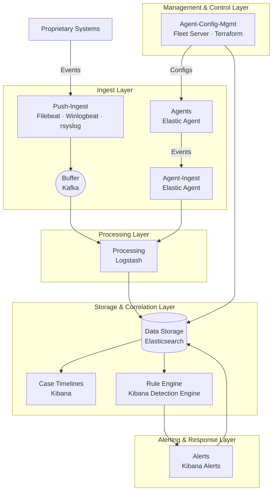

# SIEM-in-a-Box

A self-contained, containerised SIEM built on the Elastic Stack with Kafka as a resilient log transport layer. The entire core runs from a single `make up` command on any machine with Docker.

---

## Table of Contents

- [SIEM-in-a-Box](#siem-in-a-box)
  - [Table of Contents](#table-of-contents)
  - [Evaluation and Results](#evaluation-and-results)
  - [Repository Structure](#repository-structure)
  - [Core Stack](#core-stack)
    - [Services](#services)
    - [Networking and Ports](#networking-and-ports)
    - [Persistent Volumes](#persistent-volumes)
  - [Log Pipeline](#log-pipeline)
    - [How a Log Travels End-to-End](#how-a-log-travels-end-to-end)
    - [Kafka Topics and Elasticsearch Indices](#kafka-topics-and-elasticsearch-indices)
    - [Logstash Pipelines](#logstash-pipelines)
  - [Collectors](#collectors)
    - [Filebeat - Linux Auth](#filebeat---linux-auth)
    - [Filebeat - Linux Auditd](#filebeat---linux-auditd)
    - [Filebeat - Linux Full (combined)](#filebeat---linux-full-combined)
    - [Filebeat - Nginx](#filebeat---nginx)
    - [Winlogbeat - Windows Security](#winlogbeat---windows-security)
    - [rsyslog - pfSense Firewall](#rsyslog---pfsense-firewall)
  - [Fleet Server and Elastic Agent (Terraform)](#fleet-server-and-elastic-agent-terraform)
    - [Agent Policies](#agent-policies)
    - [Running Terraform](#running-terraform)
  - [Quick Start](#quick-start)
    - [Prerequisites](#prerequisites)
    - [Start the stack](#start-the-stack)
    - [Connect a collector](#connect-a-collector)
    - [Apply Fleet policies (optional)](#apply-fleet-policies-optional)
    - [Stop the stack](#stop-the-stack)
  - [Configuration Reference](#configuration-reference)
  - [Makefile Reference](#makefile-reference)

---



The design separates **collection** from **processing**. Collectors on the monitored hosts push compressed JSON to Kafka. Logstash consumes each Kafka topic through an independent pipeline that parses, enriches, and indexes the events. Elasticsearch stores everything; Kibana exposes the detection engine, dashboards, and Fleet management.

---

## Evaluation and Results

The [evaluation index](evaluation/README.md) maps the paper's four research questions to the measured outcomes, figures, and available run-level data. It also explains the variants and measurement boundaries. Start there when reviewing the experimental evidence.

It contains the derived tables behind every number, the results of all 269 runs, and the measurement harness with the frozen protocols and analysis scripts. The raw per-event records are distributed separately because of their size.

---

## Repository Structure

```
SIEM-in-a-box/
├── evaluation/                     # Results, derived tables, per-run results and measurement harness
├── stack/                          # Core Docker Compose stack
│   ├── docker-compose.yml          # All core services
│   ├── .env                        # Stack version, passwords, ports
│   ├── kibana.yaml                 # Kibana + Fleet bootstrap config
│   ├── logstash.yml                # Logstash node settings + monitoring
│   ├── pipeline.yaml               # Logstash multi-pipeline manifest
│   └── pipelines/                  # One .conf per log source
│       ├── nginx.conf
│       ├── linux-auth.conf
│       ├── linux-auditd.conf
│       ├── windows-security.conf
│       ├── firewall-pfsense.conf
│       └── template/pipeline.conf  # Template for new pipelines
│
├── collectors/                     # Drop-in collector configs per source
│   ├── filebeat/
│   │   ├── linux-auth/             # /var/log/auth.log → Kafka
│   │   ├── linux-auditd/           # /var/log/audit/audit.log → Kafka
│   │   ├── linux-full/             # auth + auditd + syslog combined
│   │   ├── nginx/                  # nginx access + error → Kafka
│   │   └── template/               # Blank template for new sources
│   ├── winlogbeat/
│   │   └── windows-security/       # Windows Event Log → Kafka
│   └── syslog/
│       └── pfsense/                # rsyslog omkafka for pfSense filterlog
│
├── terraform/                      # Fleet Server & Agent Policy automation
│   ├── providers.tf                # elasticstack provider (ES + Kibana)
│   ├── variables.tf                # All inputs with descriptions
│   ├── fleet_packages.tf           # Install integrations (system, nginx…)
│   ├── fleet_server.tf             # Fleet Server host registration
│   ├── policies.tf                 # Invokes the policies module
│   ├── outputs.tf
│   ├── versions.tf
│   ├── environments/
│   │   ├── lab.tfvars              # Values for local lab
│   │   └── prod.tfvars             # Values for production
│   └── policies/                   # Terraform module - agent policies
│       ├── linux_base.tf           # Generic Linux (metrics + auth/syslog)
│       ├── linux_security.tf       # Bastion hosts (+ auditd)
│       ├── linux_web.tf            # Web servers (+ nginx + apache)
│       └── windows_security.tf     # Windows (+ PowerShell/Sysmon/WEF)
│
├── scripts/
│   ├── provision-rules.sh          # Auto-provision detection rules to Kibana
│   └── manage-rules.sh             # CRUD CLI for detection rules
│
├── utils/
│   ├── setup.sh                    # TLS certificate generation (runs inside Docker)
│   ├── configure-fleet-ssl.sh      # Fleet output SSL + service token setup
│   ├── kibana-setup.sh             # Create Kibana Data Views via API
│   ├── data-views.json             # Data View definitions (index patterns)
│   └── get-certs-details.sh        # Debug helper - inspect generated certs
│
└── Makefile                        # Single entry-point for all operations
```

---

## Core Stack

### Services

The entire SIEM core lives in `stack/docker-compose.yml`. All services share the `siem-network` bridge and communicate using their service names as hostnames.

| Container | Image | Role |
|---|---|---|
| `siem-setup` | `elasticsearch:8.19.7` | Runs once at startup: generates TLS certs and sets the `kibana_system` password |
| `siem-es01` | `elasticsearch:8.19.7` | Single-node Elasticsearch cluster with xpack security and TLS enabled |
| `siem-kibana` | `kibana:8.19.7` | Kibana UI, Detection Engine, Fleet management |
| `siem-kafka` | `bitnamilegacy/kafka:3.7` | KRaft-mode Kafka broker (no ZooKeeper) |
| `siem-logstash` | `logstash:8.19.7` | Multi-pipeline log processor |
| `siem-fleet-server` | `elastic-agent:8.19.7` | Fleet Server - enrolment point for Elastic Agents |

**Startup order** (enforced by `depends_on` + health checks):

```
setup (certs ready) → es01 (healthy) → kibana (healthy) → fleet-server
                                      ↗
                         kafka (healthy) → logstash
```

### Networking and Ports

| Port | Service | Protocol | Notes |
|---|---|---|---|
| `9200` | Elasticsearch | HTTPS | REST API, used by Logstash and Kibana |
| `5601` | Kibana | HTTPS | Web UI and Kibana API |
| `9094` | Kafka | PLAINTEXT | **External** - collectors on monitored hosts connect here |
| `9092` | Kafka | PLAINTEXT | Internal - Logstash connects here (inside Docker network) |
| `9093` | Kafka | PLAINTEXT | KRaft controller (internal only) |
| `8220` | Fleet Server | HTTPS | Elastic Agent enrolment |
| `8200` | APM Server | HTTP | APM ingest (co-located with Fleet Agent) |

> **External collectors** always connect to port `9094`. Replace `<IP_DO_SIEM>` in the collector configs with the IP of the Docker host machine.

### Persistent Volumes

| Volume | Contents |
|---|---|
| `certs` | TLS certificates for all services (CA, es01, kibana, fleet-server) |
| `esdata01` | Elasticsearch data |
| `kibanadata` | Kibana saved objects |
| `kafkadata` | Kafka log segments |
| `fleetserverdata` | Fleet Server state |

> **Warning:** `make down-volumes` destroys all volumes including certificates and indexed data. Use `make down` for a soft stop.

---

## Log Pipeline

### How a Log Travels End-to-End

Below is the complete journey for a single Nginx access log line:

```
1. Nginx writes:
   192.168.1.5 - - [04/May/2026:15:30:00 +0100] "GET /api/v1 HTTP/1.1" 200 1234 "-" "curl/7.88"

2. Filebeat (on the Nginx host) reads /var/log/nginx/access.log
   → adds bench.t_filebeat_ns (nanosecond timestamp)
   → compresses with gzip
   → sends JSON to kafka:9094 topic "logs-nginx-default"

3. Kafka buffers the message in topic logs-nginx-default
   → durable, survives Logstash restarts

4. Logstash pipeline "nginx" consumes from kafka:9092
   → grok: parses IP, method, URL, status code, bytes, referrer, user agent
   → date: parses nginx timestamp → @timestamp
   → useragent: enriches user_agent fields
   → mutate: renames fields to ECS schema (source.ip, http.request.method…)
   → ruby: records bench.t_logstash_ns, computes latency deltas
   → outputs to Elasticsearch index "bench-nginx-access"

5. Kibana
   → Data View "Nginx Logs" on index pattern logs-nginx-default
   → Detection rules query the index for suspicious patterns
```

### Kafka Topics and Elasticsearch Indices

| Source | Kafka Topic | Elasticsearch Index |
|---|---|---|
| Nginx access/error logs | `logs-nginx-default` | `bench-nginx-access` |
| Linux `/var/log/auth.log` | `logs-linux-auth-default` | `logs-linux.auth-default` |
| Linux `/var/log/audit/audit.log` | `logs-linux-audit-default` | `logs-linux.audit-default` |
| Windows Event Log (Security) | `logs-windows-security-default` | `logs-windows.security-default` |
| pfSense filterlog (syslog) | `logs-firewall-pfsense-default` | `logs-pfsense.firewall-default` |

Parse failures in the auditd pipeline go to `logs-linux.audit-parse-errors` for inspection without data loss.

### Logstash Pipelines

Logstash runs in multi-pipeline mode. The manifest `stack/pipeline.yaml` defines each pipeline independently with its own worker count and batch settings. Each pipeline is isolated: a failure in one does not affect the others.

**`nginx.conf`** - Web access and error logs
- Parses the standard nginx combined log format with grok
- Classifies HTTP status codes into `log.level`: `error` (5xx), `warn` (4xx), `info` (2xx/3xx)
- Enriches user agent strings with the `useragent` filter
- Renames fields to ECS: `source.ip`, `url.original`, `http.request.method`, `http.response.status_code`

**`linux-auth.conf`** - SSH and sudo events
- Three grok patterns: SSH accepted login, SSH failed login, sudo command
- Sets `event.outcome` to `success` or `failure` based on message content
- Sets `event.category` to `authentication` or `admin`

**`linux-auditd.conf`** - Kernel audit subsystem
- Handles two input formats: structured Auditbeat ECS events and raw `type=SYSCALL msg=audit(...)` lines
- Parses raw lines with grok then extracts key=value pairs with the `kv` filter
- Maps auditd event types (`EXECVE`, `USER_LOGIN`, `PATH`…) to ECS categories
- Failed parses are routed to a separate error index

**`windows-security.conf`** - Windows Event Log
- Winlogbeat already sends structured JSON, so filtering is enrichment only
- Maps known Event IDs to ECS fields:
  - `4624` → logon-success (authentication / success)
  - `4625` → logon-failed (authentication / failure)
  - `4740` → account-locked (iam / failure)
  - `4672` → privilege-assigned (iam / admin)

**`firewall-pfsense.conf`** - pfSense packet filter logs
- Parses syslog filterlog format: rule number, interface, action, direction, IP version
- Sets `event.category: network`, `observer.type: firewall`
- Classifies `block` actions as `log.level: warn`

---

## Collectors

Collector configurations live in `collectors/`. Copy the relevant config to the target host and replace `<IP_DO_SIEM>` with the Docker host's IP address.

### Filebeat - Linux Auth

**File:** `collectors/filebeat/linux-auth/filebeat.yaml`

Monitors `/var/log/auth.log` (Debian/Ubuntu) or `/var/log/secure` (RHEL/CentOS).

Captures SSH logins (accepted and failed) and sudo usage. Sends to Kafka topic `logs-linux-auth-default`.

```bash
# Install Filebeat on the monitored Linux host, then:
cp collectors/filebeat/linux-auth/filebeat.yaml /etc/filebeat/filebeat.yml
# Edit: replace <IP_DO_SIEM>
systemctl enable --now filebeat
```

### Filebeat - Linux Auditd

**File:** `collectors/filebeat/linux-auditd/filebeat.yaml`

Monitors `/var/log/audit/audit.log`. Requires the `auditd` daemon running on the host.

```bash
apt install auditd
systemctl enable --now auditd
```

Sends raw auditd lines to topic `logs-linux-audit-default`. Logstash performs full parsing. Uses a larger `harvester_buffer_size` (64 KB) because auditd generates high-volume burst writes.

### Filebeat - Linux Full (combined)

**File:** `collectors/filebeat/linux-full/filebeat.yml`

Combines auth, auditd, and syslog into a single Filebeat instance. Uses a `kafka_topic` field per input to route each stream to its own Kafka topic via `topic: '%{[kafka_topic]}'`.

| Input | Path | Topic |
|---|---|---|
| linux-auth | `/var/log/auth.log` | `logs-linux-auth-default` |
| linux-auditd | `/var/log/audit/audit.log` | `logs-linux-audit-default` |
| linux-syslog | `/var/log/syslog` | `logs-linux-syslog-default` (disabled - pipeline not yet created) |

A Docker Compose file is included (`collectors/filebeat/linux-full/docker-compose.yml`) to run Filebeat as a container on the monitored host.

### Filebeat - Nginx

**File:** `collectors/filebeat/nginx/filebeat.yaml`

Two inputs: `access.log` (fields: `log_type: access`) and `error.log` (fields: `log_type: error`), both sent to topic `logs-nginx-default`.

Includes the bench latency processor that stamps `bench.t_filebeat_ns` (nanoseconds since epoch) on each event, used for pipeline latency measurement.

### Winlogbeat - Windows Security

**File:** `collectors/winlogbeat/windows-security/winlogbeat.yaml`

Run as a Windows service. Captures from two channels:

- **Security** - Event IDs: 4624, 4625, 4740, 4672, 4648, 4776, 4768, 4769 (logins, lockouts, Kerberos, NTLM)
- **System** - level: critical, error, warning (last 24h)

Winlogbeat serialises events as structured JSON, so the Logstash pipeline only needs to enrich (not parse) them.

```powershell
# On the Windows host:
# 1. Download Winlogbeat from elastic.co
# 2. Copy winlogbeat.yaml to the installation directory as winlogbeat.yml
# 3. Edit: replace <IP_DO_SIEM>
.\install-service-winlogbeat.ps1
Start-Service winlogbeat
```

### rsyslog - pfSense Firewall

**File:** `collectors/syslog/pfsense/rsyslog.conf`

pfSense sends packet filter logs via syslog (UDP/TCP port 514) to a Linux intermediary running rsyslog. The `rsyslog-kafka` (omkafka) module forwards only `filterlog` messages to Kafka.

Install the Kafka module on the rsyslog host:

```bash
# Debian/Ubuntu:
apt install rsyslog-kafka

# RHEL/Fedora:
dnf install rsyslog-kafka
```

Configure pfSense to send syslog to the rsyslog host's IP on port 514. The rsyslog rule filters on `$programname == "filterlog"` so unrelated syslog messages are not forwarded.

---

## Fleet Server and Elastic Agent (Terraform)

Fleet Server runs as a container inside the core stack and provides centralised management of Elastic Agents deployed on monitored hosts. Terraform manages the Fleet configuration (integrations and agent policies) as code.

### Agent Policies

Four pre-built agent policies cover the common deployment scenarios:

**`Linux - Base`** (`terraform/policies/linux_base.tf`)
- For: generic Linux servers (application servers, database servers)
- Integrations: `system` (CPU, memory, disk, network metrics + auth.log + syslog)

**`Linux - Security`** (`terraform/policies/linux_security.tf`)
- For: bastion hosts, authentication servers, high-value targets
- Integrations: `system` + `auditd` (full kernel-level audit trail)

**`Linux - Web Server`** (`terraform/policies/linux_web.tf`)
- For: servers running nginx or Apache
- Integrations: `system` + `nginx` + `apache` (apache disabled by default; enable when installed)

**`Windows - Security`** (`terraform/policies/windows_security.tf`)
- For: Domain Controllers, Windows application servers, critical workstations
- Integrations: `system` + `windows` (PowerShell logs; Sysmon and WEF disabled by default)

### Running Terraform

Prerequisites: Terraform installed, the stack running, and the CA certificate exported.

```bash
# Export the CA certificate
docker cp siem-setup:/usr/share/elasticsearch/config/certs/ca/ca.crt ./stack/certs/ca.crt

# Initialise Terraform
cd terraform
terraform init

# Apply for local lab
terraform apply -var-file=environments/lab.tfvars

# Apply for production (edit prod.tfvars first)
terraform apply -var-file=environments/prod.tfvars
```

Terraform is idempotent: re-running `apply` only changes what has drifted from the declared state.

**Installed integrations** (via `fleet_packages.tf`):

| Integration | Version | Purpose |
|---|---|---|
| `fleet_server` | 1.6.0 | Fleet Server bootstrap |
| `system` | 2.6.3 | System metrics, auth.log, syslog |
| `nginx` | 3.0.0 | Nginx access and error logs |
| `apache` | 3.0.0 | Apache access and error logs |
| `auditd` | 3.22.1 | Linux kernel audit logs |
| `windows` | 3.5.0 | Windows Event Log, PowerShell, Sysmon |

---

## Quick Start

### Prerequisites

- Docker Engine ≥ 24 with Docker Compose plugin
- At least 8 GB RAM available for Docker (Elasticsearch and Kafka are memory-intensive)
- The Docker socket accessible (`sudo usermod -aG docker $USER`, then re-login)

### Start the stack

```bash
# 1. Start all core services (first start takes 3–5 minutes for cert generation)
make up

# The command blocks until Elasticsearch is healthy, then prints:
#   Kibana: https://localhost:5601 (elastic/elastic)
```

### Connect a collector

Pick the appropriate config from `collectors/`, copy it to the target host, replace `<IP_DO_SIEM>` with the SIEM host IP, and start the collector service.

Example for a Linux host:

```bash
# On the target Linux host:
apt install filebeat

# Copy and edit the config
scp collectors/filebeat/linux-full/filebeat.yml target-host:/etc/filebeat/filebeat.yml
ssh target-host "sed -i 's/<IP_DO_SIEM>/192.168.0.23/' /etc/filebeat/filebeat.yml"

systemctl enable --now filebeat
```

### Apply Fleet policies (optional)

```bash
# Export the CA cert first
docker cp siem-setup:/usr/share/elasticsearch/config/certs/ca/ca.crt ./stack/certs/ca.crt

cd terraform
terraform init
terraform apply -var-file=environments/lab.tfvars
```

### Stop the stack

```bash
make down             # Stop containers, preserve volumes
make down-volumes     # Stop containers AND delete all data
```

---

## Configuration Reference

All stack configuration is driven by `stack/.env`. Edit this file before the first `make up`.

| Variable | Default | Description |
|---|---|---|
| `STACK_VERSION` | `8.19.7` | Version of all Elastic Stack images |
| `ELASTIC_PASSWORD` | `elastic` | Password for the `elastic` superuser |
| `KIBANA_PASSWORD` | `kibana` | Internal password for the `kibana_system` user |
| `ES_PORT` | `9200` | Elasticsearch host port |
| `KIBANA_PORT` | `5601` | Kibana host port |
| `FLEET_PORT` | `8220` | Fleet Server host port |
| `APMSERVER_PORT` | `8200` | APM Server host port |
| `CLUSTER_NAME` | `siem-cluster` | Elasticsearch cluster name |
| `LICENSE` | `basic` | License type (`basic` or `trial`) |
| `MEM_LIMIT` | `2147483648` | Memory limit per service (2 GB) |
| `ENCRYPTION_KEY` | *(set)* | Kibana encryption key for saved objects |
| `ELASTIC_APM_SECRET_TOKEN` | `supersecrettoken` | APM secret token |

> **Production note:** Change `ELASTIC_PASSWORD`, `KIBANA_PASSWORD`, and `ENCRYPTION_KEY` before deploying. The encryption key must be at least 32 characters.

---

## Makefile Reference

```
make up             Start the core stack and wait for Elasticsearch to be healthy
make down           Stop containers (volumes are preserved)
make down-volumes   Stop containers and delete all volumes (data loss warning)
make down-all       Stop core stack + observability + sources stacks
make status         Show running container status and Elasticsearch cluster health
make verify         List Elasticsearch indices and Logstash pipeline event counts
make help           Print available targets
```

**Environment overrides** (pass as `make up VAR=value`):

| Variable | Default |
|---|---|
| `ELASTIC_PASSWORD` | `elastic` |
| `ELASTIC_USER` | `elastic` |
| `ES_URL` | `https://localhost:9200` |
| `KIBANA_URL` | `https://localhost:5601` |
| `KAFKA_BOOTSTRAP` | `localhost:9094` |
