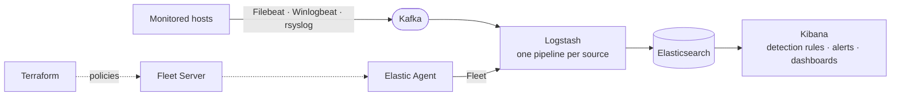

# SIEM-in-a-Box

**Affordable and resilient security monitoring for small and medium enterprises.**

SIEM-in-a-Box is a self-contained, containerised SIEM built on the Elastic Stack, with Kafka as a buffering transport between log collection and processing. The whole core starts with a single `make up` on any machine with Docker.

 [Website](https://ieeta-pt.github.io/SIEM-in-a-box/) · [Technical docs](docs/README.md) · [Evaluation](evaluation/README.md)

---

## Why SIEM-in-a-Box

- **One command to run.** Elasticsearch, Kibana, Kafka, Logstash and Fleet Server come up together with TLS certificates generated automatically.
- **No lost events during backend outages.** Kafka buffers events while Elasticsearch or Logstash is down; UDP sources lost no events during backend pauses of up to ten minutes.
- **Attacks stay visible under log floods.** Each source has its own Kafka topic and Logstash pipeline, so a flood of web logs does not delay authentication events.
- **Ready-made sources.** Collectors and parsing pipelines for Linux auth, auditd, Nginx, Windows Security and pfSense, mapped to ECS.
- **Configuration as code.** Fleet agent policies and integrations are managed with Terraform.

## Architecture



Details of each layer, container, port and volume are in [Architecture](docs/architecture.md).

## Quick start

**Requirements:** Docker Engine ≥ 24 with the Compose plugin, and at least 8 GB of RAM available to Docker.

```bash
git clone https://github.com/ieeta-pt/SIEM-in-a-box.git
cd SIEM-in-a-box
make up        # first start takes 3–5 minutes
```

Open Kibana at <https://localhost:5601> (user `elastic`, password `elastic`).

Then connect a monitored host. For example, a Linux server with Filebeat:

```bash
scp collectors/filebeat/linux-full/filebeat.yml target-host:/etc/filebeat/filebeat.yml
ssh target-host "sed -i 's/<IP_DO_SIEM>/192.168.0.23/' /etc/filebeat/filebeat.yml && systemctl enable --now filebeat"
```

Use `make status` to check the services, `make verify` to see events arriving, and `make down` to stop (data is kept).

> The defaults are for a lab. Change the passwords and the encryption key in `stack/.env` before any real deployment; see [Configuration](docs/configuration.md#production-hardening).

## Supported sources

| Source | Collector | Pipeline |
| --- | --- | --- |
| Linux SSH and sudo | Filebeat | `linux-auth` |
| Linux kernel audit | Filebeat | `linux-auditd` |
| Nginx access and error | Filebeat | `nginx` |
| Windows Security events | Winlogbeat | `windows` |
| pfSense firewall | rsyslog → Kafka | `firewall` |
| Any host with Elastic Agent | Fleet (Terraform policies) | Elastic integrations |

New sources are added from the templates; see [Adding a new log source](docs/log-pipeline.md#adding-a-new-log-source).

## Evaluation

SIEM-in-a-Box was evaluated in four campaigns, 269 runs and 179 million accounted events on a single CPU-pinned host, against a Filebeat-to-Elasticsearch path without Kafka and a single-node Wazuh.

| Result | SIEM-in-a-Box |
| --- | --- |
| Event loss from UDP sources during backend pauses of up to 10 min | **0%** |
| Attack-event loss during a 6,000 events/s log flood | **0%** (Wazuh: 13.8–16.6%) |
| Attack events that raised a Kibana alert under flood | **2,999 of 2,999** |
| Median indexing latency at 1,000 events/s | **150 ms** |
| Sustained load on one host | **3,000** events/s (file), **4,000** events/s (UDP) |
| Cost of the Kafka buffer at 1,000 events/s | about **0.35 CPU cores and 1.7 GiB** |

The [evaluation index](evaluation/README.md) explains each research question, the limitations (such as the single Kafka broker), and links every number to its derived table and runs.

## Documentation

| | |
| --- | --- |
| [Architecture](docs/architecture.md) | Layers, services, ports, volumes |
| [Log pipeline](docs/log-pipeline.md) | Event flow, topics and indices, Logstash pipelines, new sources |
| [Collectors](docs/collectors.md) | Filebeat, Winlogbeat and rsyslog setup per source |
| [Fleet and Terraform](docs/fleet-terraform.md) | Agent policies and integrations as code |
| [Configuration and operations](docs/configuration.md) | `.env`, Makefile, rule scripts, hardening |

## Repository structure

```
stack/        Core Docker Compose stack and Logstash pipelines
collectors/   Drop-in Filebeat, Winlogbeat and rsyslog configs
terraform/    Fleet Server and agent policies as code
scripts/      Detection rule provisioning and management
utils/        Certificates, Fleet SSL and Kibana Data View setup
evaluation/   Results, derived tables, per-run data and measurement harness
docs/         Website and technical documentation
```

## Citation

If you use SIEM-in-a-Box in your research, please cite: *SIEM-in-a-Box: Affordable and Resilient Security Monitoring for Small and Medium Enterprises*.
