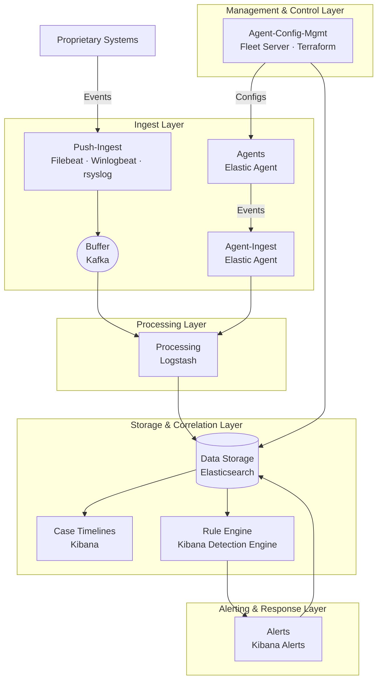

# Architecture

[← Technical documentation](README.md)

SIEM-in-a-Box separates **collection** from **processing**. Collectors on the monitored hosts push compressed JSON to Kafka. Logstash consumes each Kafka topic through an independent pipeline that parses, enriches and indexes the events. Elasticsearch stores everything; Kibana exposes the detection engine, dashboards and Fleet management.



## Services

The whole core lives in [`stack/docker-compose.yml`](../stack/docker-compose.yml). All services share the `siem-network` bridge and reach each other by service name.

| Container | Image | Role |
| --- | --- | --- |
| `siem-setup` | `elasticsearch:8.19.7` | Runs once at startup: generates TLS certificates and sets the `kibana_system` password. |
| `siem-es01` | `elasticsearch:8.19.7` | Single-node Elasticsearch cluster with X-Pack security and TLS. |
| `siem-kibana` | `kibana:8.19.7` | Kibana UI, Detection Engine and Fleet management. |
| `siem-kafka` | `bitnamilegacy/kafka:3.7` | Kafka broker in KRaft mode (no ZooKeeper). |
| `siem-logstash` | `logstash:8.19.7` | Multi-pipeline log processor. |
| `siem-fleet-server` | `elastic-agent:8.19.7` | Fleet Server, the enrolment point for Elastic Agents. |

### Startup order

Enforced by `depends_on` and health checks:

```
setup (certs ready) → es01 (healthy) → kibana (healthy) → fleet-server
                                      ↗
                         kafka (healthy) → logstash
```

## Networking and ports

| Port | Service | Protocol | Notes |
| --- | --- | --- | --- |
| `9200` | Elasticsearch | HTTPS | REST API, used by Logstash and Kibana. |
| `5601` | Kibana | HTTPS | Web UI and Kibana API. |
| `9094` | Kafka | PLAINTEXT | **External** listener: collectors on monitored hosts connect here. |
| `9092` | Kafka | PLAINTEXT | Internal listener: Logstash connects here inside the Docker network. |
| `9093` | Kafka | PLAINTEXT | KRaft controller, internal only. |
| `8220` | Fleet Server | HTTPS | Elastic Agent enrolment. |
| `8200` | APM Server | HTTP | APM ingest, co-located with the Fleet agent. |

> External collectors always connect to port `9094`. Replace `<IP_DO_SIEM>` in the collector configs with the IP of the Docker host.

## Persistent volumes

| Volume | Contents |
| --- | --- |
| `certs` | TLS certificates for all services (CA, es01, kibana, fleet-server). |
| `esdata01` | Elasticsearch data. |
| `kibanadata` | Kibana saved objects. |
| `kafkadata` | Kafka log segments. |
| `fleetserverdata` | Fleet Server state. |

> **Warning:** `make down-volumes` destroys every volume, including certificates and indexed data. Use `make down` for a soft stop.
